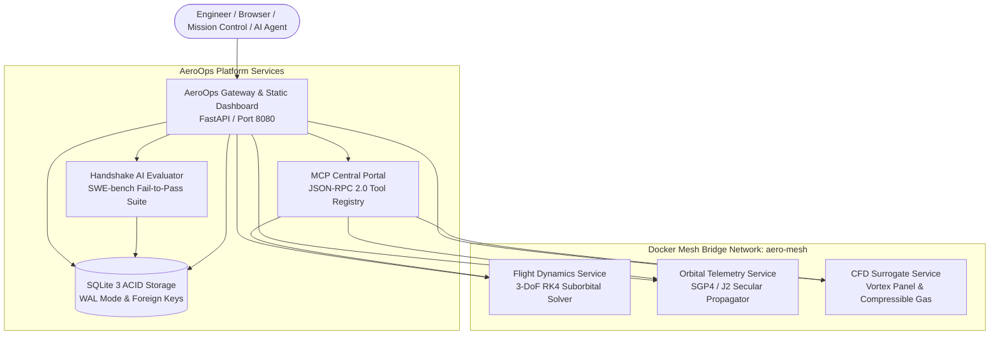

# Aerospace Operations Stack (AeroOps) 🛰️🚀

[](https://github.com/perfectalone375/aerospace-ops-stack/actions)
[](https://www.docker.com/)
[](https://docs.docker.com/compose/)
[](https://www.python.org/)
[](https://opensource.org/licenses/MIT)
[](https://fastapi.tiangolo.com/)
[](https://github.com/astral-sh/ruff)
[](tests/)

Cloud-Native Aerospace Microservices Stack, ACID Database Telemetry Hub, Model Context Protocol (MCP) Central Portal, and Handshake AI Physical Simulation Benchmark Evaluation Suite orchestrated with **Docker Compose**.

AeroOps acts as an enterprise operations hub coordinating 3-DoF computational flight dynamics, real-time SGP4 satellite orbit propagation, physics-informed CFD surrogate aerodynamic modeling, Model Context Protocol (MCP) tool exposure for autonomous AI agents, and Handshake AI / SWE-bench code evaluation harnesses with atomic SQLite WAL database persistence.

---

## 🏛️ Microservice Systems Architecture



---

## 🚀 Key Platform Capabilities

### 1. Unified Mission Control UI (`/`)
* **Real-time Canvas Telemetry Gauges:** Instantaneous visual rendering of suborbital altitude, axial acceleration, Mach number, and dynamic pressure Max-Q.
* **Interactive Orbital World Map:** Dynamic sine ground-track projection displaying satellite subpoint, velocity vector, and ground station elevation coverage circle.
* **Aerodynamic Surface Pressure Chart ($C_p$):** Chordwise suction loop and stall onset rendering for NACA 4-digit profiles.
* **Model Context Protocol (MCP) Interactive Console:** Live dropdown tool selector and argument JSON runner executing standardized tools across physics calculation engines.
* **Handshake AI Benchmark Workbench:** Interactive problem inspector and candidate solution patch evaluator verifying mathematical continuity across sonic singularities and coordinate branch cuts.
* **Persistent SQLite Audit Log Table:** Live table rendering indexed simulation runs and telemetry events directly from SQLite WAL storage.

### 2. Model Context Protocol (MCP) Central Portal
Exposes 6 standardized tools following the Model Context Protocol specification:
* `simulate_staged_rocket`: Multi-stage suborbital rocket trajectory with discrete casing jettison.
* `propagate_attitude_quaternions`: 6-DoF rigid-body attitude dynamics using unit quaternions $[q_0, q_1, q_2, q_3]$ avoiding gimbal lock.
* `calculate_oblique_shock`: 2D planar supersonic oblique shock wave angle $\beta$, pressure ratio $P_2/P_1$, and total pressure loss.
* `predict_transonic_divergence`: Korn-Mason transonic drag divergence Mach number and wave drag rise.
* `calculate_bielliptic_transfer`: Three-impulse bi-elliptic transfer trajectory budget comparison against Hohmann transfers.
* `evaluate_handshake_ai_task`: Automated SWE-bench physical simulation patch evaluation harness.

### 3. Handshake AI Physical Simulation Benchmark Suite
Comprehensive SWE-bench style benchmark containing 8 challenge problems with dual fail-to-pass and pass-to-pass validation suites:
* `AERO-001`: Prandtl-Glauert Sonic Singularity Hyperbolic Tangent Bridge.
* `AERO-002`: Ground Station Zenith Pass Azimuth 360-Degree Branch Cut Angle Unwrapping.
* `AERO-003`: NACA Airfoil Full Cosine Cluster Discretization & Trailing Edge Kutta Condition.
* `AERO-004`: Stodola De Laval Nozzle Real-Gas Compressibility Correction.
* `AERO-005`: Dual-Pulse Solid Motor Multi-Stage Center of Mass Depletion Migration.
* `AERO-006`: Unit Quaternion Normalization & Gimbal Lock Prevention.
* `AERO-007`: Supersonic Oblique Shock Detachment Beta Angle Root Solver.
* `AERO-008`: Bi-Elliptic vs Hohmann Delta-V Crossover Ratio Optimum ($R_2/R_1 > 11.94$).

### 4. Zero-Dependency ACID Database Persistence
* SQLite3 storage utilizing **Write-Ahead Logging (WAL)** mode for concurrent readers and zero-lock execution.
* Cascading foreign key constraints between simulation runs and discrete staging telemetry events.
* Indexed analytical SQL queries powering the dynamic AI evaluation leaderboard.

---

## ⚡ Quick Start with Docker Compose

### 1. Launch with Docker Compose

```bash
# Clone the repository
git clone https://github.com/perfectalone375/aerospace-ops-stack.git
cd aerospace-ops-stack

# Build and start all services in detached mode
docker compose up --build -d

# Check cluster status
docker compose ps
```

Visit the Mission Control interface in your browser:
👉 **`http://localhost:8080`**

### 2. Run Locally with Python

```bash
pip install -e ".[dev]"
aero-ops
# Or: uvicorn aerospace_ops.gateway:app --port 8080 --reload
```

---

## 📡 REST API Specification

| Endpoint | Method | Tag | Description |
|---|---|---|---|
| `/api/health` | `GET` | `system` | Aggregated microservice health check matrix (DB, MCP, Gateway) |
| `/api/simulation/flight` | `POST` | `telemetry` | Runs 3-DoF suborbital trajectory integration |
| `/api/simulation/orbit` | `POST` | `telemetry` | Propagates satellite orbit and ground station pass |
| `/api/simulation/cfd` | `POST` | `telemetry` | Evaluates airfoil pressure distribution and polar |
| `/api/simulation/full-mission` | `POST` | `telemetry` | Executes end-to-end multi-disciplinary aerospace simulation |
| `/api/db/runs` | `POST` | `database` | Atomically persists simulation run and staging events to SQLite |
| `/api/db/runs` | `GET` | `database` | Retrieves paginated historical simulation runs |
| `/api/db/runs/{run_id}` | `GET` | `database` | Retrieves run details and discrete telemetry events |
| `/api/db/leaderboard` | `GET` | `database` | Computes live AI evaluation leaderboard from SQL store |
| `/api/mcp/tools` | `GET` | `mcp` | Enumerates Model Context Protocol tools and schemas |
| `/api/mcp/invoke` | `POST` | `mcp` | Dynamically executes an MCP tool with schema validation |
| `/api/handshake/tasks` | `GET` | `handshake` | Lists SWE-bench / Handshake AI benchmark challenge tasks |
| `/api/handshake/evaluate` | `POST` | `handshake` | Validates candidate patch against fail-to-pass test suite |
| `/metrics` | `GET` | `observability` | Prometheus metrics scrape target |
| `/` | `GET` | `ui` | Serves interactive Mission Control single-page app |

---

## 🧪 Testing & Verification

```bash
# Run pytest test suite
pytest --cov=aerospace_ops

# Run Ruff code style checks
ruff check .

# Validate Docker Compose syntax
docker compose config
```

---

## 📄 License

This project is licensed under the **MIT License** - see the [LICENSE](LICENSE) file for details.

Engineered with precision by **[Gopi Naga Vignesh Thirupati](https://github.com/perfectalone375)**.
