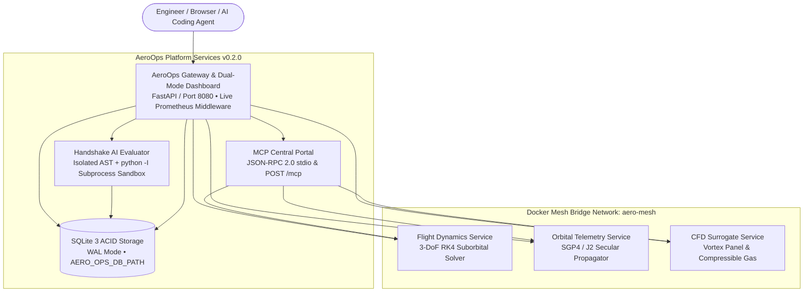

# Aerospace Operations Stack (AeroOps) 🛰️🚀

[](https://github.com/perfectalone375/aerospace-ops-stack/actions)
[](https://perfectalone375.github.io/aerospace-ops-stack/)
[](https://www.docker.com/)
[](https://docs.docker.com/compose/)
[](https://www.python.org/)
[](https://opensource.org/licenses/MIT)
[](https://fastapi.tiangolo.com/)
[](https://github.com/astral-sh/ruff)
[](tests/)

**Live Interactive Mission Control Demo:** 👉 **[perfectalone375.github.io/aerospace-ops-stack](https://perfectalone375.github.io/aerospace-ops-stack/)**

Cloud-Native Aerospace Microservices Stack, ACID SQLite WAL Telemetry Hub, **JSON-RPC 2.0 Model Context Protocol (MCP) Central Portal**, and **Handshake AI Sandboxed Code Evaluation Suite** orchestrated with **Docker Compose**.

AeroOps acts as an enterprise operations hub coordinating 3-DoF computational flight dynamics, real-time SGP4 satellite orbit propagation, physics-informed CFD surrogate aerodynamic modeling, native MCP `stdio` / HTTP tool exposure for autonomous AI agents, and isolated AST-verified Handshake AI / SWE-bench code evaluation harnesses with persistent SQLite WAL storage.

---

## 🏛️ Microservice Systems Architecture



---

## 🚀 Key Platform Capabilities

### 1. Dual-Mode Mission Control UI (`/`) & GitHub Pages Live Demo
* **Real-time Canvas Telemetry Gauges:** Instantaneous visual rendering of suborbital altitude, axial acceleration, Mach number, and dynamic pressure Max-Q.
* **Interactive Orbital World Map:** Dynamic sine ground-track projection displaying satellite subpoint, velocity vector, and ground station elevation coverage circle.
* **Aerodynamic Surface Pressure Chart ($C_p$):** Chordwise suction loop and stall onset rendering for NACA 4-digit profiles.
* **MCP JSON-RPC 2.0 Console:** Live dropdown tool selector invoking `/mcp` using standard JSON-RPC payloads.
* **Handshake AI Workbench (`Buggy Starter` vs `Gold Solution`):** Inspect 8 aerospace SWE-bench problems, execute starter vs candidate patches against real isolated physics tests, and view per-test pass/fail breakdowns.
* **Dual-Mode Architecture:** Connects natively to FastAPI + SQLite WAL locally/Docker, and gracefully runs an interactive client-side demo when hosted statically on GitHub Pages.

### 2. Model Context Protocol (MCP) Central Portal (`stdio` & `POST /mcp`)
Implements MCP Specification **`2024-11-05`** (`initialize`, `notifications/initialized`, `ping`, `tools/list`, `tools/call`, `resources/list`, `resources/read`):
* **Tools:** `simulate_staged_rocket`, `propagate_attitude_quaternions`, `calculate_oblique_shock`, `predict_transonic_divergence`, `calculate_bielliptic_transfer`, `evaluate_handshake_ai_task`.
* **Live MCP Resources:** `aeroops://handshake/tasks`, `aeroops://db/runs`, `aeroops://db/leaderboard`.
* **CLI & IDE Integration:** Exposes `aero-ops-mcp` (`python -m aerospace_ops.mcp.server`) and registers directly via [`scripts/setup_claude_desktop_mcp.py`](scripts/setup_claude_desktop_mcp.py).

### 3. Handshake AI Isolated AST + Subprocess Benchmark Suite
Evaluates candidate patches (raw Python or unified diffs) by running `ast.parse` security checks (blocking `os`, `subprocess`, `eval`, `exec`, dunder attributes) followed by isolated `python -I` subprocess execution with strict timeout protection against deterministic numerical invariants:
* `AERO-001`: Prandtl-Glauert Sonic Singularity Hyperbolic Tangent Bridge.
* `AERO-002`: Ground Station Zenith Pass Azimuth 360-Degree Angle Unwrapping.
* `AERO-003`: NACA Airfoil Cosine Clustering Discretization & Trailing Edge Kutta Condition.
* `AERO-004`: Euler-Bernoulli Center-Load Beam Maximum Deflection Coefficient Fix ($PL^3 / 48EI$).
* `AERO-005`: Solid Rocket Motor Burnout Non-Negative Propellant Mass Clamp.
* `AERO-006`: Unit Quaternion Euler Angle Extraction Gimbal Lock Guard at $\pm 90^\circ$ Pitch.
* `AERO-007`: 2D Supersonic Oblique Shock Detachment Boundary Pre-Check ($\theta_{\max}$ Golden-Section Solver).
* `AERO-008`: 3-Impulse Bi-Elliptic vs Hohmann Orbital Transfer Efficiency Crossover Criterion ($r_2/r_1 > 11.94$).

### 4. Production SQLite WAL & Live Prometheus Telemetry
* Configurable database location via `AERO_OPS_DB_PATH` (mounted to persistent Docker volume `/app/data/aero_ops.db`).
* Thread-safe FastAPI HTTP telemetry middleware powering dynamic counters and latency summaries (`0.5` / `0.99` quantiles) at `/metrics`.

---

## ⚡ Quick Start

### 1. Launch with Docker Compose

```bash
git clone https://github.com/perfectalone375/aerospace-ops-stack.git
cd aerospace-ops-stack
docker compose up --build -d
docker compose ps
```

Visit **`http://localhost:8080`** (API docs at **`http://localhost:8080/docs`**).

### 2. Run Locally with Python

```bash
pip install -e ".[dev]"
aero-ops          # Starts FastAPI gateway + UI on port 8080
aero-ops-mcp      # Starts JSON-RPC 2.0 MCP server over stdio
```

---

## 📡 API & Protocol Specification

Full exported OpenAPI 3.1 specification is stored in [`deliverables/openapi_schema.json`](deliverables/openapi_schema.json), and verified benchmark telemetry in [`deliverables/handshake_benchmark_report.json`](deliverables/handshake_benchmark_report.json).

| Endpoint | Method | Tag | Description |
|---|---|---|---|
| `/api/health` | `GET` | `system` | Aggregated microservice health matrix (DB, MCP, AST Sandbox) |
| `/mcp` | `POST` | `mcp` | Native Model Context Protocol JSON-RPC 2.0 transport |
| `/api/mcp/tools` | `GET` | `mcp` | Enumerates registered MCP tools and JSON schemas |
| `/api/mcp/invoke` | `POST` | `mcp` | Dynamically executes an MCP tool via REST |
| `/api/handshake/tasks` | `GET` | `handshake` | Lists Handshake AI benchmark tasks with starter & reference code |
| `/api/handshake/evaluate` | `POST` | `handshake` | Evaluates candidate patch in isolated AST subprocess & saves to DB |
| `/api/db/runs` | `POST` / `GET` | `database` | Persists or lists simulation runs and telemetry events |
| `/api/db/runs/{run_id}` | `GET` | `database` | Retrieves run details and staging telemetry events |
| `/api/db/leaderboard` | `GET` | `database` | Computes live SQL-aggregated model evaluation leaderboard |
| `/api/simulation/*` | `POST` | `telemetry` | Physics endpoints (`flight`, `orbit`, `cfd`, `transfer`, `compressible`, `full-mission`) |
| `/metrics` | `GET` | `observability` | Live Prometheus telemetry scrape endpoint |
| `/` | `GET` | `ui` | Dual-mode interactive Mission Control dashboard |

---

## 🧪 Testing & Verification

```bash
pytest --cov=aerospace_ops
ruff check .
docker compose config
```

---

## 📄 License

This project is licensed under the **MIT License** - see the [LICENSE](LICENSE) file for details.

Engineered by **[Gopi Naga Vignesh Thirupati](https://github.com/perfectalone375)**.
